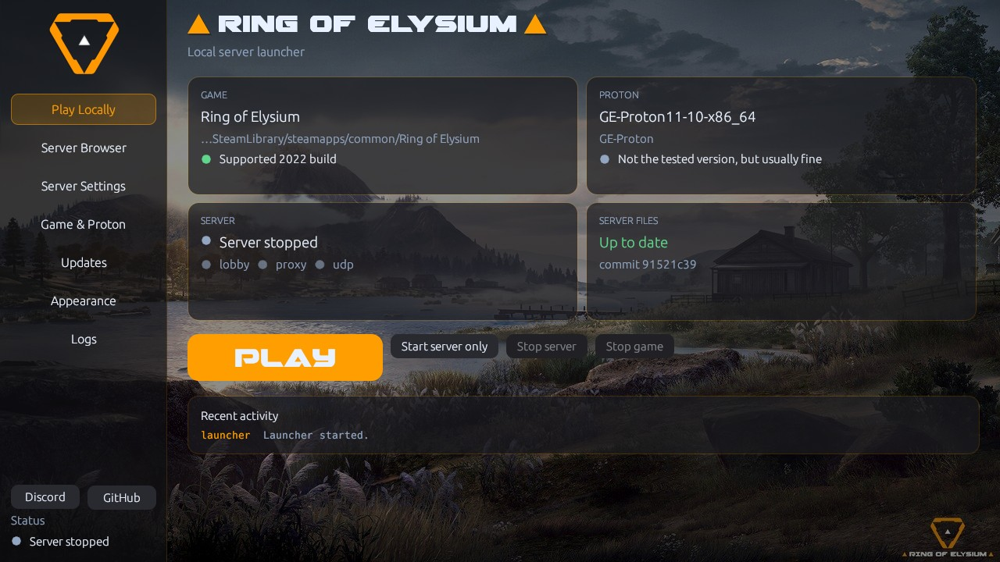

# Ring of Elysium — Local Launcher



A native desktop launcher (Rust + egui) for **Linux and Windows** that starts **Ring of Elysium** together with the
community **local server** ([ROE-LIVE/ring-of-elysium-local](https://github.com/ROE-LIVE/ring-of-elysium-local)),
keeps that server up to date from GitHub, and gets out of your way: one **PLAY** button does the rest.

* **Linux:** runs the game through the Proton of your choice (GE-Proton recommended).
* **Windows:** starts the game directly, no Proton or Wine needed.

Unofficial fan tooling. It contains no game files: you bring your own copy of the game
(the supported **2022 build**). See [Artwork, font and licence](#artwork-font-and-licence) about the bundled images.

## Download

Get the latest release from the **[Releases page](https://github.com/darknetcs/roe-launcher/releases/latest)**:

| System | File |
|---|---|
| Linux x86_64 (any distro with glibc 2.35+: Ubuntu 22.04+, Debian 12, Fedora, Arch, SteamOS …) | `roe-launcher-linux-x86_64.tar.gz` |
| Windows 10 / 11, 64-bit | `roe-launcher-windows-x86_64.zip` |

Each file has a `.sha256` next to it, and from v0.1.10 on a GitHub **build provenance attestation**: proof that it
was built by this repository's release workflow from the public source
(`gh attestation verify <file> -R darknetcs/roe-launcher`). From v0.1.1 on, the launcher **updates itself** (Updates
page), so you only download it once.

**Project documents:** [Privacy policy](PRIVACY.md) · [Security policy](SECURITY.md) · [Changelog](CHANGELOG.md) ·
third-party licences (`THIRD-PARTY-LICENSES.html` in every package) · [Notices](NOTICE.md) · [MIT licence](LICENSE)

## Quick start

### Linux
On **Debian, Ubuntu, Zorin, Mint, Pop!\_OS** and other Debian-based systems, install Python's venv module first
(Fedora, Arch, openSUSE and SteamOS include it with Python):
```bash
sudo apt install python3 python3-venv
```
Then:
```bash
tar xf roe-launcher-linux-x86_64.tar.gz
./roe-launcher/roe-launcher
```
A `roe-launcher.desktop` file is included if you want a menu entry.

If you started the launcher before installing `python3-venv` and it failed with *"No module named pip"*, just press
**PLAY** again: the launcher repairs its Python environment by itself (from v0.1.12; with v0.1.11 or older,
delete `~/.local/share/roe-local/server/.tools/venv` first).

### Windows
1. Unzip `roe-launcher-windows-x86_64.zip` anywhere you can write to (e.g. `Documents\roe-launcher`).
2. Run `roe-launcher.exe`. The download isn't code-signed, so Windows SmartScreen may warn:
   choose **More info → Run anyway**. Some antivirus programs also flag it; see
   [Windows: antivirus warnings](#windows-antivirus-warnings).

### Then, on both
Check that **Play Locally** shows your game (it is found through Steam automatically) and press **PLAY**.
No game installed? The button reads **INSTALL vIA StEAm**: it opens Steam's install dialog for Ring of Elysium
(it must be in your Steam library), and turns into **PLAY** once Steam has finished the download.

The first start downloads what the server needs (a few hundred MB), then startup is quick:
* the server files from GitHub;
* **Linux:** a Python environment with the pinned dependencies, and a private .NET 8 SDK if you have none;
* **Windows:** a portable Python 3.12 (checksum-verified) and the .NET 8 SDK, kept inside the server folder.
  Nothing is installed system-wide, and no PowerShell is used.

## What it does

| Area | Details |
|---|---|
| **Play** | One button: prepares the server, starts it, waits until its ports are up, then starts the game. When the game closes, the server it started is stopped again. You can also run the server on its own. |
| **Server Settings** | Every match option the installed server offers, read from the server itself and grouped (Match, Targets & bots, Map & world, Vehicles, Network). New upstream options show up after an update without a launcher release. Includes **practice targets** (up to 10 targets on the map) and live control. Clear error messages when the server refuses a combination. |
| **Tencent crash reporter** | Game page: optionally **block TQMCenter**, the game's own crash and telemetry collector that can report to Tencent. No game file is changed; untick to allow it again. See [PRIVACY.md](PRIVACY.md). |
| **Player name** | Your own name in the lobby, on the map selection, in the newspaper and on the stats screen (Server Settings → Player name; up to 16 English letters, digits, spaces and symbols). Everyone starts as **BRING_BACK_ROE!!**, the original server's name, now shown in the match too. Applied each time the server starts, so it survives server updates. Empty restores the server's untouched files (the match then says "LOCAL"). |
| **Map** *(experimental)* | Server Settings → Map. **Dione** is the community server's map and works in Training. **Kill Zone** can be picked for testing: it loads and plays, but you can't extract (the helicopter appears outside the final zone, too high to reach). **Desert** (you fall through the ground) and **Dione at night** (the game freezes at the start) are shown greyed out. The server only has Dione's spawn points, loot, zones and evacuation, so other maps need server support first. A warning next to PLAY reminds you when an experimental map is selected. |
| **Server status** | Live indicators for the lobby (TCP 9001), proxy (TCP 8001) and endpoint (UDP 18001), uptime, pid, and the server's own output. A server you started yourself is detected and left alone. |
| **Install via Steam** | When no game is found, the main button asks Steam to install it (Steam is called directly, so it works even without a `steam://` link handler; manual steps and a copyable link if Steam can't be reached). While Steam downloads it shows **INSTALLING…**, and it only uses the game once Steam reports the install complete, also when the download was started in Steam itself. |
| **Game location** | Found automatically in your Steam libraries, including libraries on other drives (Linux: `libraryfolders.vdf` of native or Flatpak Steam; Windows: Steam's registry entry). You can always browse or paste a path. The `Europa_Client.exe` hash is checked against the supported 2022 build. |
| **Proton** *(Linux)* | Reads Steam's compatibility tools: GE-Proton, Proton-CachyOS, Proton-EM, UMU-Proton, Valve's Proton, anything with a `proton` script. Choose a fixed version, *"always the newest GE-Proton / CachyOS / …"*, or any custom folder. |
| **Server updates** | Keeps its own copy of the server files and updates it from GitHub (exact-commit download; keeps your saved profiles, the Python/.NET tools, run logs and reports). Optionally re-applies the bundled **English translation** after every update. |
| **Launcher updates** | Checks this project's releases at start. *Update now* downloads the package for your system, installs it only if it matches the release's SHA-256 file and replaces the launcher in place; *Restart now* opens the new version (not while the game or server runs). |
| **Server Browser** *(preview)* | Your local server, servers you save, launchers found on your network and an optional online list, with search, filters and favourites. **LAN play:** host a Training session on one computer and **Join** it from another on the same network, or over **Hamachi** or **Radmin VPN** (see [Playing on your network](#playing-on-your-network-lan)). Other internet servers can't be joined yet. |
| **Discord** | *Discord* and *GitHub* buttons in the sidebar. Optional **Rich Presence** (Appearance → Discord, off by default): friends see "Playing Ring of Elysium" and whether you're in the launcher, hosting a server or in a match, with links to the community and the launcher. Works with the regular, Flatpak and Snap Discord apps, and only while Discord runs on your computer. |
| **Look** | Ring of Elysium styling (logo, and tab titles and PLAY in the *Gemina 2* font). 4 colour themes, your own accent and text colours, 4 bundled backgrounds or your own images, darkening, panel opacity, interface size, and falling snow or a sandstorm. |

## Requirements

**Linux**
* A desktop with OpenGL (Mesa or a vendor driver), X11 or Wayland.
* `python3` ≥ 3.11 **with venv** (Debian, Ubuntu, Zorin, Mint …: `sudo apt install python3 python3-venv`). Without
  `python3-venv` the launcher still sets up pip itself, with PyPA's `get-pip.py`.
* Steam + a Proton runtime (GE-Proton recommended; `GE-Proton11-7` is the tested one).
* `xdg-desktop-portal` for the file dialogs (present on all mainstream desktops).

**Windows**
* Windows 10 or 11, 64-bit, with an OpenGL-capable graphics driver (any current GPU driver).
* Steam with the game installed. Nothing else: Python and .NET are downloaded by the launcher.

**Both:** internet access on the first start (GitHub, PyPI, python.org on Windows, Microsoft's .NET download; on Linux
without `python3-venv` also bootstrap.pypa.io).

## Where things live

| What | Linux | Windows |
|---|---|---|
| Settings | `~/.config/roe-local/launcher.toml` | `%APPDATA%\roe-local\launcher.toml` |
| Server files (changeable) | `~/.local/share/roe-local/server` | `%LOCALAPPDATA%\roe-local\server` |
| Python / .NET for the server | `server/.tools/` | `server\.tools\` (same layout as upstream's `play.cmd`, so both can share it) |
| Saved profiles (character, cosmetics) | `server/runtime/local-account/` (named: `local-accounts/NAME/`) | `server\runtime\local-account\` |
| Run logs of every session | `server/runs/` | `server\runs\` |
| Launcher log (and crash reports) | `~/.local/share/roe-local/launcher.log` | `%LOCALAPPDATA%\roe-local\launcher.log` |
| Your backgrounds | `~/.local/share/roe-local/backgrounds` | `%LOCALAPPDATA%\roe-local\backgrounds` |
| Wine prefix | the game's own Steam prefix, otherwise `~/.local/share/roe-local/prefix` | — (not needed) |

Each server start creates a new session folder in `runs/` with that session's settings and logs; that's how the
server works, not a reset of your player. Only the newest 20 are kept (Server Settings > Session > *Keep session
logs*, 0 = keep all); older ones are deleted when the launcher starts. Your **profile** (the character and
cosmetics you choose in the lobby) is the only thing the server saves between sessions, and updates keep it.

Added background images are **copied** into the launcher's folder, so moving or deleting the original changes
nothing. That folder is deliberately outside the server folder, because server updates replace the server folder.
On Linux the launcher also imports the answers saved by the old `play-roe.sh` scripts.

## Updating

**Server files** (Updates page):
1. The latest commit is read from GitHub's public Atom feed, falling back to the REST API and finally to git's
   smart-HTTP refs, so a rate limit never blocks you.
2. The exact commit is downloaded as an archive (no `git` needed) and swapped in. Your data is kept: `runtime/`
   (saved profiles: the character and cosmetics you pick in the lobby), `runs/` (session logs), `reports/` and
   `.tools/` (Python/.NET).
3. If enabled, the built-in translator rewrites Russian comments and messages to English. New upstream text that
   isn't in its dictionary stays Russian and is counted on the Updates page.

**The launcher itself** (Updates page → Launcher): see the table above. From v0.1.11 on, an update also replaces the
documents next to the launcher (licences, privacy policy, notices, README), so they always match the version you run.
It needs a writable launcher folder; otherwise download the new release by hand. On Windows the replaced file is kept as `roe-launcher.old.exe` until
the next start.

HTTPS uses the **system certificate store**, so corporate proxies and custom CAs work.

## Uninstalling

The launcher is portable: it has no installer and changes nothing in your system. To remove it completely:

1. Close it (stop the server first if it runs).
2. Delete the launcher's own folder (where you unpacked it).
3. Delete its data:

   | | Linux | Windows |
   |---|---|---|
   | Settings | `~/.config/roe-local/` | `%APPDATA%\roe-local\` |
   | Server files, Python/.NET, logs, backgrounds | `~/.local/share/roe-local/` | `%LOCALAPPDATA%\roe-local\` |

   The second folder also holds your saved lobby profile (character and cosmetics) and the session logs.
4. Only if you set them up: remove the Steam launch option from
   [Playing from Steam's Play button](#playing-from-steams-play-button-linux), and on a Linux LAN host the firewall
   rules (`sudo ufw delete allow 28001,29001/tcp && sudo ufw delete allow 18110/udp`). On Windows, the firewall rule
   for the launcher can be removed under *Windows Security → Firewall → Allow an app*.

The game itself is not touched: uninstall it through Steam as usual.

## Playing from Steam's Play button (Linux)

The launcher is the easy way to play, but you can also start the game from Steam (for its overlay or playtime
tracking). Start the server first (**Play Locally → Start server only**), then set the game's launch options in
Steam (**Ring of Elysium → Properties → General → Launch options**) to this single line:

```sh
sh -c 'for a; do shift; case "$a" in -maintenance|-steam) ;; *) set -- "$@" "$a";; esac; done; exec "$@"' sh %command% -language=en -garena -uid=1 -server=127.0.0.1:8001
```

**Why it's needed:** since the official shutdown, Steam starts the game with `-steam -maintenance`, and you can't
remove those from Steam's settings. `-maintenance` makes the game treat the servers as closed for maintenance, so
it never tries to connect to any server, including a community one. The line above passes everything else through
unchanged, drops those two switches, and adds the address of your local server. Steam's loader then starts the
supported DirectX 9 client by itself (the in-game DX12 option is greyed out, as it should be).

**Why the launcher is still the better choice:**
- **Servers:** the address is written into the launch options by hand, so every other server means editing
  Steam's settings. The launcher fills it in for you, and the Server Browser will do the same for other servers
  when they can be joined.
- **Everything else:** the launcher also starts and stops the server with the game, applies your **Player name**
  and checks that you have the supported game build.

A server started on its own stops when its session length runs out (Server Settings, default 25 minutes), even in
the middle of a match, so raise it for long sessions.

**Linux only:** this tip is for the Linux Steam client and has not been tested on Windows. On Windows, play through
the launcher.

## Playing on your network (LAN)

One computer hosts, another joins. No accounts, passwords or extra software are needed: the launchers find each
other and carry the game's traffic between the two computers themselves. Both computers need launcher v0.1.9 or
newer and the game.

**On the computer that hosts:**
1. **Server Settings → Network** → tick **Let others on my network join this computer's server**.
2. **Play Locally** → **Start server only**. The Server Browser then shows *Hosting: others can join…*.
3. **Firewall:** Windows asks once to allow the launcher; allow it on *private* networks. On Linux with a
   firewall such as ufw, open the ports once (the launcher shows this line too):
   `sudo ufw allow 28001,29001/tcp && sudo ufw allow 18110/udp`

**On the computer that plays:** **Server Browser** → **Refresh** → the host appears with **Join** enabled → **Join**.
The game starts and plays on the host's server; closing the game closes the connection.

**Over Hamachi or Radmin VPN** (v0.1.11 or newer on both computers): both join the same Hamachi or Radmin VPN
network, the host sets up hosting as above, and the player adds the host's VPN address (Hamachi `25.x.x.x`, Radmin
VPN `26.x.x.x`) under **Server Browser → Hosts by address** and presses **Refresh**. The network search can't see
VPN peers by itself, which is why the address is added by hand. On a Windows host, Windows often treats the VPN as a
*public* network: allow the launcher on public networks too, or set the VPN's network to *Private*.

**Good to know:**
* **Training only, one player per host.** The community server offers Training mode (single-player in the original
  game too) and takes one player, so the host itself can't play while hosting, and two players can't share a match.
* **The host's settings apply:** its map, match options and Player name.
* **Finding hosts:** the search asks every address of your network directly as well as broadcasting, so it also
  works when the player's own firewall would drop broadcast answers.
* **Private networks only:** a host only accepts computers on private networks (192.168.x.x, 10.x.x.x,
  172.16–31.x.x) and on Hamachi (25.x.x.x) or Radmin VPN (26.x.x.x).
* Tested both ways between Windows and Linux.

## Windows: antivirus warnings

A few antivirus engines (mostly machine-learning ones, e.g. on VirusTotal) may flag `roe-launcher.exe` as suspicious.
These are false positives: the launcher is a new, unsigned program that does things such tools are wary of on paper:
it updates itself, starts helper programs (Python, .NET, the game) without console windows and, for LAN play, opens
network ports.

**Check that your copy is genuine:** compare the SHA-256 of the zip with the `.sha256` file on the
[Releases page](https://github.com/darknetcs/roe-launcher/releases/latest) (PowerShell:
`Get-FileHash roe-launcher-windows-x86_64.zip`). The exe is built by GitHub Actions from this repository's public
source, and it carries version details (publisher, description) under *Properties → Details*. If an engine flags the
genuine file, please let us know; we report false positives to the vendors.

## Windows: setting up Python and .NET by hand

On the first start the launcher downloads a portable Python, pip and the .NET 8 SDK into the server folder. Some
antivirus "web shields", proxies or networks hold these downloads, and the launcher then stays on *Working… /
Preparing Python and .NET…* (in `.tools\downloads` you see a `.part` file that stays at 0 KB). You can do those steps
yourself; the launcher skips every step that is already done.

**First:** close the launcher (check Task Manager for leftover `roe-launcher.exe` and `python.exe`) and delete the
`.part` file. Allowing `roe-launcher.exe` in your antivirus' web/HTTPS protection often fixes it already.

The server folder is `%LOCALAPPDATA%\roe-local\server` (paste it into Explorer's address bar), unless you chose
another one in the launcher. Test builds use one folder per server: `server` (ROE-LIVE), `server-roe-rivival`,
`server-kowalski`. Below, `.tools` means the `.tools` folder inside it; create it if it doesn't exist.

| Step | Download | Put it here |
|---|---|---|
| 1. Python 3.12 | [python-3.12.10-embed-amd64.zip](https://www.python.org/ftp/python/3.12.10/python-3.12.10-embed-amd64.zip) (11 MB) | Unzip into `.tools\python\` so that `.tools\python\python.exe` exists (not `.tools\python\python-3.12.10-embed-amd64\python.exe`). |
| 2. pip | [get-pip.py](https://bootstrap.pypa.io/get-pip.py) (save the page with *Save as*) | Only if the launcher hangs on *Setting up pip…*: see below. |
| 3. Python packages | — (pip fetches them from PyPI) | Nothing to do; the launcher shows pip's progress and errors in Recent activity. |
| 4. .NET 8 SDK | [dotnet-sdk-win-x64.zip](https://aka.ms/dotnet/8.0/dotnet-sdk-win-x64.zip) (about 280 MB) | Unzip into `.tools\dotnet\` so that `.tools\dotnet\dotnet.exe` exists. The .NET installer (.exe) does **not** help: the launcher uses only this folder. |

After each step press **PLAY** again; the launcher continues with the next one.

For step 1, the zip's SHA-256 should be `4acbed6dd1c744b0376e3b1cf57ce906f9dc9e95e68824584c8099a63025a3c3`
(PowerShell: `Get-FileHash python-3.12.10-embed-amd64.zip`).

For step 2, first do step 1 and press **PLAY** once (the launcher then configures the portable Python; it may hang on *Setting up pip…* again),
close it, and
run this in a Command Prompt from the server folder, with the path where you saved `get-pip.py`:

```bat
.tools\python\python.exe "%USERPROFILE%\Downloads\get-pip.py" --no-warn-script-location
```

If PyPI itself is blocked in step 3, run from the server folder:
`.tools\python\python.exe -m pip install --only-binary=:all: -r requirements.txt` and look at its error.

Still stuck? Open an [issue](https://github.com/darknetcs/roe-launcher/issues) with your `launcher.log`
(`%LOCALAPPDATA%\roe-local\launcher.log`).

## Known limitations

* **Only Training is implemented** by the community server; other game modes don't exist yet.
* **Internet servers can't be joined yet.** LAN play works, also over Hamachi or Radmin VPN (see above); joining
  other servers over the internet is planned.
* **Practice targets vs. Bots:** the server's scripted bot (*Bots*) needs *Target* set to `none`, so it can't be
  combined with practice targets. The launcher shows the server's reason when a combination is refused.
* **Windows:** stopping the server ends it at once, so the run logs miss their final "stopped" lines (gameplay is
  not affected).
* **No controller support in the game client**, so there is no handheld mode for now (the groundwork is kept on
  the `handheld` branch).

## Build from source

```bash
cargo build --release -p roe-launcher     # Linux binary: target/release/roe-launcher
cargo test  -p roe-core                   # 58 unit tests, no GUI needed
```
For maximum portability build on an old glibc (the CI uses Ubuntu 22.04). The GUI libraries
(X11/Wayland/GL/xkbcommon) are loaded at run time, so nothing GUI-specific is needed to *build*.

**Windows** builds are cross-compiled from Linux with MinGW:
```bash
rustup target add x86_64-pc-windows-gnu          # plus the mingw-w64 gcc package of your distro
cargo build --release -p roe-launcher --target x86_64-pc-windows-gnu
```
The release workflow (`.github/workflows/release.yml`) does all of this on every `v*` tag: Linux build and tests
on Ubuntu 22.04, the core tests on a real Windows runner, then the Windows build, and attaches both packages and
their checksums to the release.

## Project layout

* `crates/roe-core` — everything that is not drawing: Steam/Proton detection, config, server and launcher updates,
  translation, Python/.NET preparation, server options, server/game command construction, process supervision
  (process groups on Linux, job objects on Windows), Server Browser model and LAN discovery. Unit-tested.
* `crates/roe-launcher` — the egui application.
* `crates/roe-core/examples/headless.rs` — end-to-end run of the core against live GitHub, no GUI.

Development switches: `ROE_START_PAGE=server|game|updates|appearance|logs|browser`, `ROE_AUTORUN=update|server|play`,
`ROE_SCREENSHOT=<file.png>` (save the window after start-up, then close), `ROE_PRETEND_NO_GAME=1` (act as if the
game is not installed, to try *Install via Steam*; settings are not changed), `ROE_DISCORD_APP_ID=<id>` (Rich
Presence with another Discord application).

**Server Browser internals:** `roe-core/src/servers.rs` holds the entry model, merging, favourites-first
filtering, `host:port` validation and a proposed online-list format `{"servers":[...]}` (no such list exists yet;
set its URL under *Sources*). `roe-core/src/lan.rs` finds launchers on your network: one UDP broadcast to port
18110 plus a direct query to every other address of the computer's private /24. Being findable is off by default;
when switched on, the launcher answers only computers on private networks, and only while its server runs.
`roe-core/src/relay.rs` is the LAN play relay: the host's server runs with upstream's `--lan-tunnel` and the
launcher forwards TCP 28001 → 8001 and 29001 → 19001 (private addresses only); the player's launcher listens on
127.0.0.1:8001 and :19001, forwards both to the host and runs upstream's bridge client, so the game connects to
127.0.0.1:8001 as usual.

## Credits

* **[ROE-LIVE](https://github.com/ROE-LIVE/ring-of-elysium-local)** for the community local server the launcher
  runs, and its profiles, LAN tunnel and translations.
* **awpstar** ([MLVP](https://github.com/MLVP)) and the four people working with them on
  [roe_server_previw](https://github.com/MLVP/roe_server_previw), for sharing their server work (user accounts,
  lobby, map modes) and their permission to use it in the launcher.
* Everyone in the community who tested, reported bugs and sent screenshots: they shaped every release.

## Artwork, font and licence

The code is MIT-licensed (`LICENSE`); contributions are welcome (`CONTRIBUTING.md`). The launcher is built from
open-source Rust libraries; their licence notices are listed in `THIRD-PARTY-LICENSES.html` (generated with
`cargo-about` from `about.toml` and shipped in every package).

`crates/roe-launcher/assets/` holds the Ring of Elysium logo and four backgrounds (the game publisher's artwork).
They are not covered by this project's licence; see `NOTICE.md`. The tab titles and the PLAY button are drawn with
the *Gemina 2* font by Iconian Fonts, free for non-commercial use (`assets/fonts/gemina2.txt`, shipped with every
release). To build without them, replace those files (keep the
names) or adjust `src/assets.rs`.

## Ideas / roadmap
* **Live control panel**: heal, ammo and target damage during a match, with one click.
* **Profiles**: pick or create named profiles (separate characters and cosmetics).
* **Doctor page**: one-click diagnostics (Python, .NET, GL, prefix, ports, hash) with a copyable report.
* **Proton downloader** (Linux): fetch the newest GE-Proton, verify it, install it into `compatibilitytools.d`.
* Joining servers over the internet, tray icon, restart-on-crash, AppImage/Flatpak.
